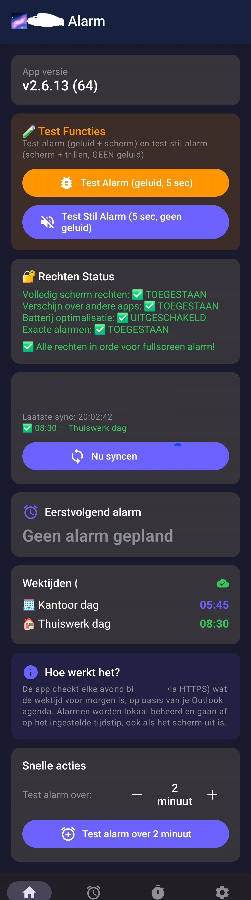
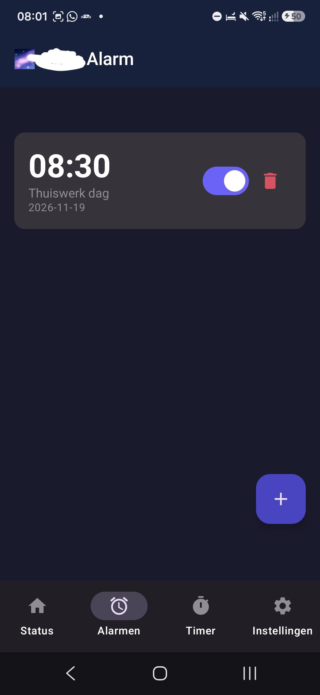
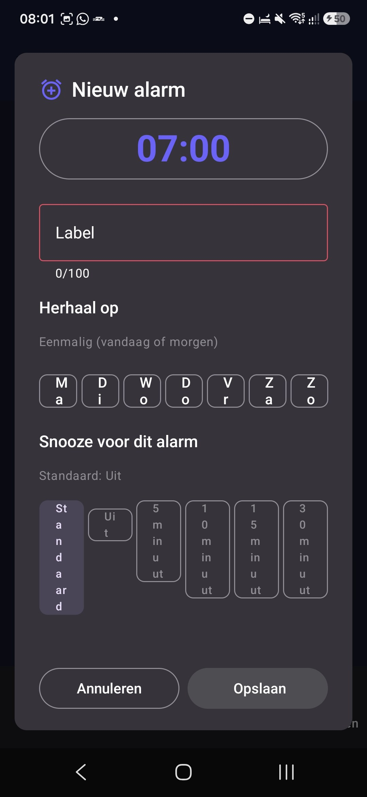
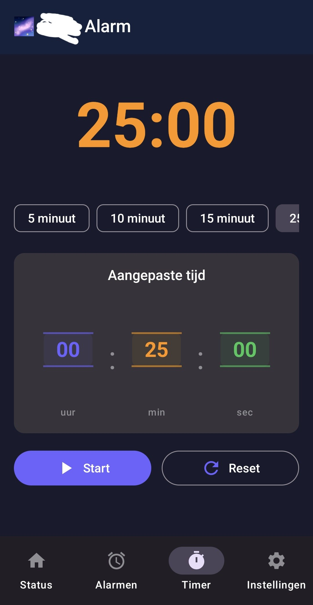
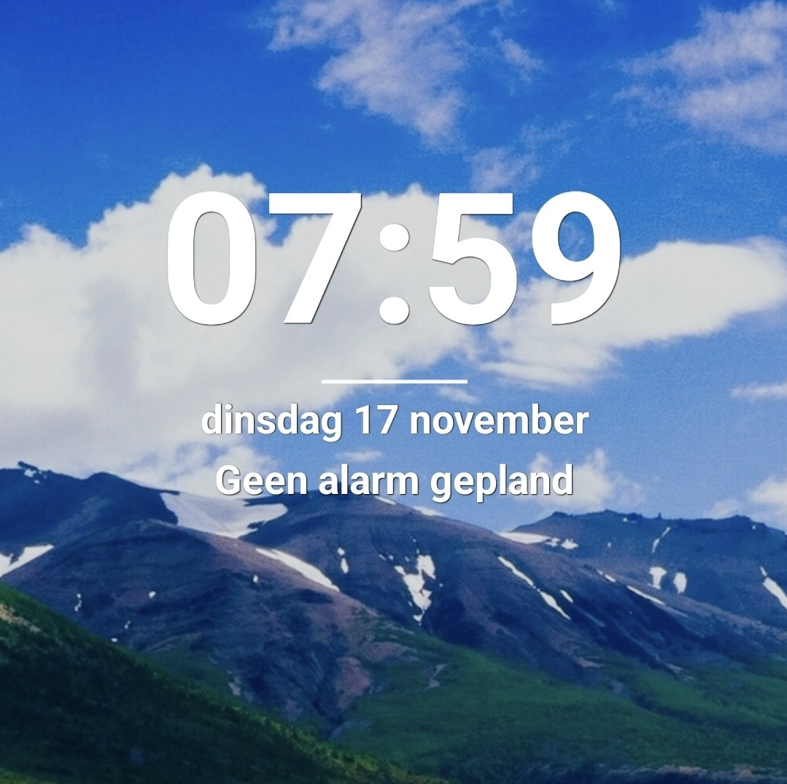
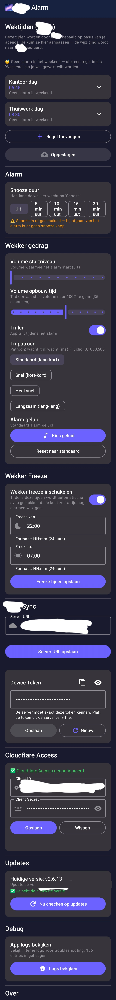

# Calendar Alarm

An open-source Android alarm-clock app that looks at **tomorrow's calendar** and picks a
sensible wake-up time for it — earlier on office days, later when you work from home,
and no alarm at all on days off. The calendar logic runs on a small self-hosted backend
that you control; the app simply pulls the result over HTTPS.

- **Android app** (Kotlin + Jetpack Compose, `android/`) — minSdk 26 (Android 8.0), targetSdk 35
- **Backend API** (Python/FastAPI, `server/`) — Dockerized, designed to sit behind a reverse proxy
- Current version: **2.6.13** (`io.github.calendaralarm`)

## Features

- **Calendar-driven wake time** — the app polls `GET /api/alarm/next` on your backend; the
  backend reads tomorrow's events from your Microsoft 365/Outlook calendar via Microsoft
  Graph and matches event subjects against configurable keyword rules (e.g. `office`,
  `home`, `off`) to choose the wake time.
- **Reliable exact alarms** — alarms are scheduled with `AlarmManager.setAlarmClock()`
  and fire a full-screen ringing activity over the lock screen.
- **Pre-alarm notification** — a heads-up 60 minutes before the alarm, with "turn off" and
  "skip this time" actions.
- **Manual alarms** — add your own alarms with labels, repetition days, snooze and skip.
- **Countdown timer** — with live countdown notification and full-screen ringing on finish.
- **Home-screen widget** — live clock, date and next alarm.
- **Rule editing from the app** — read and edit the server-side keyword rules via
  `GET`/`POST /api/config`.
- **Self-hosted updates** — optional update feed (`version.json` + SHA-256-verified,
  signature-checked APK downloads).
- **Optional Cloudflare Access** — send service-token headers so the API sits behind
  Cloudflare Access.
- **Optional certificate pinning** — SPKI SHA-256 pins baked in at build time.
- **Log upload** — the app can upload its sanitized in-app log buffer to `POST /api/log`
  for remote debugging.
- **Privacy-conscious by design** — no analytics, no ads, no cleartext traffic, tokens and
  credentials stored in `EncryptedSharedPreferences` (Android Keystore).

## Screenshots

Screenshots show the Dutch UI (the app follows the phone language; English is the default).

| Status | Alarms | New alarm | Timer |
|:---:|:---:|:---:|:---:|
|  |  |  |  |

| Home-screen widget | Settings (full page) |
|:---:|:---:|
|  | <a href="docs/screenshots/settings.jpg"></a> |

## Architecture

```
┌──────────────────────┐        HTTPS (pull)         ┌──────────────────────────┐
│  Android app         │  ─────────────────────────► │  Backend API (FastAPI)   │
│  Calendar Alarm         │   GET /api/alarm/next       │  - device token auth     │
│  - WorkManager sync  │   GET/POST /api/config      │  - rate limiting         │
│  - AlarmManager      │   POST /api/log             │  - reads calendar via    │
│  - full-screen UI    │ ◄─────────────────────────  │    Microsoft Graph       │
│  - widget, timer     │   JSON responses            │  - keyword rule matching │
└──────────────────────┘                             └──────────┬───────────────┘
                                                                │ HTTPS
                                                                ▼
                                                     ┌──────────────────────────┐
                                                     │ Microsoft Graph API      │
                                                     │ /me/calendarview         │
                                                     │ (your M365/Outlook cal)  │
                                                     └──────────────────────────┘
```

The app never receives a push — it initiates all connections (pull model), so the backend
needs no inbound firewall rules. In production the API is expected to sit behind a reverse
proxy (the included `docker-compose.yml` ships Traefik labels) and optionally Cloudflare
Access.

See [docs/ARCHITECTURE.md](docs/ARCHITECTURE.md) for the full component breakdown and
[docs/API.md](docs/API.md) for the HTTP API.

## Quick start

### 1. Run the backend

```bash
cd server
cp .env.example .env          # set CALALARM_DEVICE_TOKEN and CALALARM_API_HOST
cp alarm_config.example.json data/alarm_config.json
mkdir -p data/logs
docker run --rm -v "$PWD/data:/data" alpine:3 chown -R 10001:10001 /data
chmod 600 data/*.json
docker compose up -d --build
```

The container runs as a non-root user with a read-only root filesystem; only `./data` is
mounted (as `/data`). See [docs/INSTALL.md](docs/INSTALL.md) for the full setup, including
the Microsoft Graph app registration and token files the server needs in `data/`
(`ms_token.json`, `ms_app_config.json`) — see [docs/BACKEND.md](docs/BACKEND.md).

### 2. Build the app

```bash
cd android
cp gradle.properties.template gradle.properties
# optionally set CALALARM_API_URL etc. in gradle.properties (see docs/CONFIGURATION.md)
./gradlew :app:assembleRelease     # or :app:assembleDebug
```

Install the APK on your phone (sideload), then in the app's Settings enter:

- **Server URL** — e.g. `https://alarm-api.example.com`
- **Device token** — the same `CALALARM_DEVICE_TOKEN` you set on the server

… and grant the permissions Android asks for: exact alarms ("Alarms & reminders"),
notifications, full-screen intent ("Appear on top" / display over other apps on some
devices) and exemption from battery optimization. Details in
[docs/INSTALL.md](docs/INSTALL.md) and [docs/TROUBLESHOOTING.md](docs/TROUBLESHOOTING.md).

## Documentation

- [docs/INSTALL.md](docs/INSTALL.md) — server setup, app build, sideload, first-run settings
- [docs/CONFIGURATION.md](docs/CONFIGURATION.md) — all build-time properties and env vars
- [docs/ARCHITECTURE.md](docs/ARCHITECTURE.md) — components and data flow
- [docs/API.md](docs/API.md) — backend HTTP API reference
- [docs/BACKEND.md](docs/BACKEND.md) — backend deployment details
- [docs/CALENDAR-PROVIDERS.md](docs/CALENDAR-PROVIDERS.md) — calendar backends
- [docs/TROUBLESHOOTING.md](docs/TROUBLESHOOTING.md) — common problems and fixes
- [CHANGELOG.md](CHANGELOG.md) — version history
- [CONTRIBUTING.md](CONTRIBUTING.md) — how to contribute

## Roadmap

The goal is **no server at all**: sign in to your calendar inside the app (or just use
the calendars already on your phone) and let everything sync and run on the device.
The self-hosted backend stays available as an optional add-on. See [ROADMAP.md](ROADMAP.md).

## Status & honesty

- This is a **personal project by the maintainer**, not a commercial product. It is tested
  on **Samsung Galaxy phones (One UI) running Android 14/15 by one household**, and the code
  contains Samsung-specific workarounds (foreground service against the OOM killer,
  `SYSTEM_ALERT_WINDOW` for the overlay ringing activity, `onKeyUp` key handling). It may
  work on other devices, but that is not guaranteed.
- It is **not on the Google Play Store**; you install the APK yourself.
- Development was **heavily AI-assisted**, with changes verified by testing on real devices.
- The calendar backend currently uses **Microsoft Graph** (see
  [docs/CALENDAR-PROVIDERS.md](docs/CALENDAR-PROVIDERS.md)).
- Licensed under the [PolyForm Noncommercial License 1.0.0](LICENSE.md) — free for personal and noncommercial use; commercial use requires a separate license, see [COMMERCIAL.md](COMMERCIAL.md).

## License

Copyright (c) 2026 the Calendar Alarm maintainer.

Source-available under the [PolyForm Noncommercial License 1.0.0](LICENSE.md).
Personal use, modification and noncommercial sharing are free. If you want to make
money with it, you need a commercial license — see [COMMERCIAL.md](COMMERCIAL.md).
This is **not** an OSI-approved open-source license.
